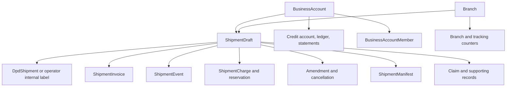

# Tenant data ownership audit

Status: source audit plus the first approved root-ownership migration on the test Atlas database. The operator feature flag remains disabled; this document does not authorize operator access to operational data.

## Findings from the current branch

- The backend registers 129 Mongoose models from 120 model files. This branch applies the tenant-owned schema plugin to 44 model files: the original shipment/account-credit records plus first-release rates, counters, audit entries, notifications, idempotency records, and the email outbox. Several platform identity and Swiftline-only models intentionally use other ownership rules; the remaining release-independent domains still need route/job classification.
- Swiftline authorization is built around global `User.role`, business-account membership, and branch assignment. A source search found at least 154 account/branch lookup call sites in controllers, services, and routes. Tenant ownership therefore needs to be applied across each connected workflow, not just the shipment list.
- Existing records are Swiftline records. The current schema has no operator-owned operational records to migrate.
- The tenant registry is isolated behind `OPERATOR_PORTAL_ENABLED`; the registry can create only draft operators. Keep that gate off until tenant ownership and legacy route boundaries are implemented.

## Record graph that must remain together

Many child records refer to a shipment, business account, or branch rather than holding a direct owner. Tenant scope must be derived from and checked against that parent relationship. A browser supplied business-account ID, branch ID, tracking number, or document key cannot establish tenant ownership.

## Candidate ownership by domain

| Ownership boundary | Models and records | Migration notes |
|---|---|---|
| Tenant-owned business data | `BusinessAccount`, `Branch`, `BusinessAccountMember`, `BusinessAccountInvitation`, `AddressBookEntry`; shipment drafts, invoices, events, charges, amendments, cancellations, manifests, quotes, imports, documents, and their counters; credit, prepaid, payment, claims, support, and notifications | These records belong to the Swiftline tenant today. Operators will need tenant-local records in the shared database, with ownership retained through parent links and verified on reads and writes. |
| Swiftline operational data for the first operator release | DPD/ALS configuration and carrier booking/tracking records; pickup dispatch, drivers, delivery partners, POD operations, flight/linehaul, flight cost, and hub operations manifests | The confirmed operator release uses internal labels and manual tracking. These Swiftline carrier and fulfilment workflows must remain Swiftline-owned and must not process operator shipments. `ShipmentManifest` is separate from Swiftline's `OperationsManifest`. |
| Platform identity and control plane | `Tenant`, `TenantSlug`, `TenantMembership`, `User`, `UserSession`, `FeatureMigration` | A user identity is global; authority comes from active tenant membership plus business-account membership and branch permissions. Never derive tenant authority from `User.role` or a URL slug alone. |
| Shared infrastructure or tenant-aware infrastructure | `AuditLog`, `EmailOutbox`, `EmailPreference`, `EmailSuppression`, `IdempotencyKey`, `WebhookEvent`, `PortalNotification`, rate and exchange caches, counters, operational settings | These models need an explicit owner decision per record. Audit and delivery infrastructure may be shared, while each event or notification needs tenant context. Idempotency scopes and business counters must not collide across tenants. |
| Reference and policy data requiring a scope decision | country and route pricing, payment terms, claim policy, service disruptions, regulatory updates, dashboard banners, booking pauses, and Swiftline routes | Some are currently global Swiftline configuration. Operator pricing and terms must be tenant-owned; platform-wide reference data can remain shared and read-only. |

The domain table is a first classification, not permission to migrate every listed model with the same update. Child collection ownership and optional relationships must be checked from each model and service before any backfill runs.

## Constraints that affect the migration

1. **Business identity indexes:** `BusinessAccount.accountId` and live contact email, mobile, and registration identifiers now use tenant-scoped unique indexes. This lets the same customer identity exist independently in Swiftline and an operator while preserving duplicate checks inside each tenant. The explicit migration `npm run migrate:business-account-tenant-indexes -- --database <expected-database-name>` is dry-run by default, checks tenant ownership and duplicate groups, creates scoped indexes, then removes the superseded global unique indexes. `Branch.code` and `Branch.labelCode` remain globally unique while the shared tracking-number generator uses them; make them tenant-local together with tenant-namespaced counters and tracking numbers.
2. **Financial and tracking numbers:** invoice, credit note, cancellation invoice, claim, ticket, manifest, pickup, and tracking counters currently use Swiftline-wide keys. New operator numbering must include tenant scope where the identifier is tenant-issued. Existing numbers and IDs must remain unchanged.
3. **Membership cardinality:** `BusinessAccountMember` currently permits one current account membership per user. `TenantMembership` permits one membership per user per tenant. The desired model should allow one authenticated person to have isolated memberships in multiple businesses or tenants when appropriate; membership checks must always include tenant and account.
4. **Global identity/session:** email and phone identity and `UserSession` are global today. If one person can switch between Swiftline and operator portals, each request must resolve its tenant from an authenticated membership and the session must not confer cross-tenant authority.
5. **Audit and idempotency:** audit entries and idempotency records currently lack a tenant field. Add tenant context to new records and preserve old audit history. Keep idempotency unique within the correct tenant and operation scope.
6. **Documents and background work:** many documents are stored by key and authorized through a parent record. Downloads, exports, public tracking, carrier webhooks, scheduled jobs, notifications, and imports need the same parent tenant check as interactive API requests.
7. **Write coverage:** account and branch creation occurs through staff and public onboarding flows. Backfilling existing records alone would leave later Swiftline writes unowned. All creation paths must write the Swiftline tenant before reads start requiring tenant scope.

## Safe implementation order

1. Finish the model and route ownership map, including all background jobs, public endpoints, exports, and storage access. Record direct and parent-derived ownership per model.
2. Run `npm run audit:tenant-data -- --schema-only` first, then `npm run audit:tenant-data -- --database <expected-database-name>` in the backend. Schema-only mode checks the reviewed relationship definitions without connecting to MongoDB. The read-only database audit reports per-collection counts, missing or invalid tenant IDs, dangling tenant-owner references for every tenant-owned model, dangling or malformed reviewed parent references, and cross-tenant parent references where both schemas carry tenant ownership. For ten reviewed shipment child models, it also checks that copied business-account and branch IDs still match the referenced shipment draft. Add `--orphan-summary` to group dangling references by a small schema-validated set of lifecycle enums and timestamp-presence flags; it never prints record IDs or personal fields. The audit disables Mongoose automatic index creation and performs no writes. Consistency across other legacy child models remains a release gate; expand the reviewed links as domains are inventoried.
3. **Completed on test Atlas for the current slices:** add the Swiftline tenant and tenant ownership to business accounts and branches, tag the reviewed shipment workflow slice, then tag client memberships, invitations, address-book entries and credit records. The shipment and account-credit migrations checked for conflicting owners, duplicate tenant-local unique keys, and any operator outside `DRAFT`; they changed only `tenantId` ownership and reviewed indexes. They did not repair the 164 dangling parent references in the latest expanded audit. Before production rollout, run separately reviewed migrations against the confirmed production database and retain their output as migration evidence.
4. Scope the corresponding Swiftline routes, files, exports, and jobs to that tenant. Add cross-tenant denial checks before enabling any operator route that reads those collections.
5. Expand by complete workflow slices. Keep operator activation disabled until every collection touched by that workflow has tenant ownership and scoped reads/writes.

## Initial read-only test database audit (historical snapshot)

The first read-only audit ran against the configured Atlas database named `swiftline` on 2026-10-21. Before the root migration, it found 19,794 documents across 113 populated collections and reported 36 unresolved parent references across the links reviewed at that time:

- 19 shipment drafts reference one missing business account; 2 invoices and 2 completed shipment charges also reference a missing business account.
- 3 business credit accounts, 7 credit ledger entries, and 1 support ticket reference missing business accounts.
- 2 business-account membership records reference missing user records (one active and one removed).
- No dangling draft, branch, DPD shipment, invoice, or claim parent links were found in the other reviewed relationships.

The current account deletion route permits deletion only for a draft account after checking current memberships and live drafts. The source does not establish that this route caused the observed references; each affected lineage needs reconciliation before migration. The audit intentionally did not print IDs or customer data and did not modify the database.

## Test Atlas root ownership migration

The reviewed migration `npm run migrate:swiftline-root-ownership -- --database swiftline --apply` completed on the test database on 2026-10-21. It created one active Swiftline tenant and current `swiftline` slug mapping, then assigned tenant ownership to all 10 business accounts and 4 branches. It does not modify their identifiers or child records.

A subsequent dry run confirmed one root tenant, one current slug mapping, 0 unassigned or conflicting business accounts, and 0 unassigned or conflicting branches. The first post-migration shipment-focused data audit saw 19,796 documents across 115 populated collections and reported 36 orphan references. A later shipment-focused audit included two additional balance-reservation relationships and found 38. No orphan records or dependent shipment/finance/document collections were changed.

## Shipment workflow lineage audit

The expanded, read-only audit ran against the test Atlas database `swiftline` on 2026-10-21. It saw 19,798 documents across 115 populated collections. It checks direct parent references, array references, and embedded shipment-manifest line references for the reviewed shipment, invoice, label, import, tracking, cancellation, credit, and manifest relationships. The audit found 38 dangling parent references and no malformed required references:

- 19 shipment drafts, 2 balance reservations, 2 tax invoices, and 2 shipment charges have dangling business-account references (25 reference occurrences).
- 3 business credit accounts, 7 credit ledger entries, and 1 support ticket have dangling business-account references (11 occurrences).
- 2 business-account membership records have dangling user references.
- Label records, shipment events' required draft links, invoice-to-booking links, shipment import entries, and manifest draft/booking/account/branch links had no dangling references in this audit.

These are relationship counts, not counts of unique deleted parent accounts. The audit does not print record IDs or customer data, does not repair rows, and exits with status 1 when it finds unresolved relationships. The two additional findings versus the earlier 36-count snapshot are balance-reservation business-account references, now included in the reviewed link set. Atlas document totals changed between snapshots; this audit is not a frozen database snapshot.

### Booking, label, invoice, tracking, and manifest coupling

- `ShipmentDraft` is the root operational record and stores its business-account and branch IDs. Existing creation paths include staff/client manual drafts, individual-counter drafts, public booking, imports, quote conversion, and rebooking. Every one of those writers must attach the correct tenant before tenant-scoped reads are enabled.
- The current booking service writes a `DpdShipment` record even when it creates only a Swiftline internal label. For destinations configured for a DPD/ALS label, the same service can also call the ALS carrier integration. Operators must be forced onto the internal-label path by server-side tenant policy; a browser flag or destination alone must not choose carrier behavior. Keep ALS/DPD booking, reconciliation, and carrier tracking unavailable to operator tenants in the first release.
- `LabelDocument` points to `DpdShipment`; shipment invoices also require both draft and booking IDs. `ShipmentManifest` requires booking IDs in each line snapshot and the existing manifest APIs select booked records through `DpdShipment` with `LABEL_RECEIVED`. Reuse of these records may be possible for internal labels, but the operator path needs an explicit tenant boundary and must not invoke carrier side effects. Preserve the existing Swiftline path while designing that boundary.
- `ShipmentInvoice` is the tax and charge document. The separate shipment/customs invoice is rendered from the booked shipment snapshot. The shared invoice service currently takes a `DpdShipment` ID, so operator invoice creation must be tenant-scoped and keep the two document types separate, with only the tax invoice participating in operator credit.
- Shipment tracking history is linked to `ShipmentDraft`. Operator tracking can use manually recorded customer-visible events only; carrier webhook/sync sources and existing global public-tracking lookup must not expose operator records. URL slugs identify routing context but do not authorize a record.
- `ShipmentManifest` is the client/account and staff combined manifest model. `OperationsManifest` is a separate Swiftline hub workflow and remains Swiftline-only. Manifest creation, exports, PDFs, and downloads all need tenant/account checks through the selected drafts.

This step verifies referential integrity for the listed edges. It does not yet prove that a child row's account and branch match its draft, that all file-storage objects exist, or that every API/job/export enforces tenant authorization. Those consistency and access checks remain implementation gates. Repeat the root migration dry run after deploying all dual-write paths to catch records written by older application instances; production rollout needs a separately reviewed migration, maintenance/cutover plan, and preflight.

### First-release ownership dependencies found in the source audit

The release-critical shipment models are already tenant-owned, but several shared models and indexes that those workflows call are not. They must be included in complete workflow slices before operator booking or manifests are enabled:

| Dependency | Current source behavior | Required tenant boundary |
|---|---|---|
| `CountryRateCard`, `CountryRouteCharge` | The original pricing service resolves shared bands or account-specific cards; staff card scope also relies on Swiftline branch permissions. This branch now adds tenant ownership and tenant-local route uniqueness. | Operator rates resolve only inside that operator tenant and for accounts in that tenant. Existing Swiftline bands/cards remain in the Swiftline root. Operator APIs must not reuse Swiftline's branch-scope helper or a shared Swiftline band. |
| `ShipmentInvoiceCounter`, `CancellationDocumentCounter` | Original counters were unique by financial year (and document type for cancellation documents), without a tenant key. This branch now declares tenant-local counter indexes. Invoice/document formatting still has Swiftline-specific prefixes. | Preserve Swiftline sequences and numbers when migrating. Operator invoices must use that operator's issuer configuration and immutable supplier snapshot; number generation and uniqueness must not collide across tenants. |
| `ShipmentManifestCounter`, `ShipmentManifest` | The original counter uses string IDs, including the historical global `shipment-manifest` SLC key. This branch now scopes counter records and namespaces operator counter IDs while preserving Swiftline keys. Manifest-number and shipment-membership unique indexes are now tenant-scoped. `actorRole` still records the legacy `admin`/`client` shape, and exports still need operator branding. | Preserve historical Swiftline SLC counter and manifest numbers. Operator actor permissions must come from tenant membership, and generated documents must use operator branding. The URL slug and actor-role snapshot do not establish record ownership. |
| `ShipmentCreditNote`, `CancellationFeeInvoice` | Both documents were already tenant-owned, but their issued document number and cancellation uniqueness constraints were global. This branch now declares tenant-local compound indexes. | Migrate the existing constraints alongside the cancellation counter. Keep immutable financial snapshots and the editable, reviewed cancellation fee behavior; never overwrite the original invoice. |
| `PortalNotification` | The original notifications were unowned and `idempotencyKey` was globally unique. This branch now adds tenant ownership and tenant-local idempotency. The same login may belong to multiple tenants. | Scope recipient queries and idempotency within the source tenant, and generate tenant-routed links. A notification from one portal must not appear in another portal for the same user. |
| `AuditLog` | The original audit entries were unowned. This branch now adds tenant ownership while preserving the existing event schema. | Keep historical Swiftline entries under the Swiftline root. New operational actions need tenant-scoped reads. Platform support actions must record the acting platform identity and target tenant with explicit audited support access. Do not infer ownership from a user role or URL slug. |
| `IdempotencyKey` | The original unique key was `(scope, userId, key)`, without a tenant. This branch now includes tenant in its unique key. | Retries in one tenant must never return a record created in another tenant by the same global login. |
| `EmailOutbox` | Delivery is shared infrastructure, but each queued message references one tenant's recipient, account, and documents. | Each message now carries `tenantId` and tenant-local idempotency. Scheduled workers enter one tenant context at a time; SES callbacks use the global message ID only to discover the owner, then update the row in that owner's context. Attachment kinds that reference shared or Swiftline-only models still need classification before operators can enqueue them. `EmailPreference` and `EmailSuppression` remain global because they apply to the person's email identity across tenants. |

`ShipmentEvent` is already tenant-owned and is the candidate store for manually entered customer-visible operator tracking events. The Swiftline-named tracking counter and carrier sync/webhook models remain Swiftline-only; operator status entry must not call carrier polling or allocate from the Swiftline tracking counter. `OperationsManifest` and its hub/flight children are separate from `ShipmentManifest` and remain Swiftline-only. Quote, pickup, public-booking, prepaid-wallet, claims, support, flight, and final-mile workflows are outside the confirmed first release unless separately added to scope.

The tenant-owned schema plugin adds query scoping to Mongoose query operations and aggregates. Direct native collection calls bypass that middleware and must be explicitly tenant-filtered or confined to reviewed migration/audit scripts. The SES callback has one reviewed cross-tenant discovery read keyed by the transport's SES message ID; it resolves each outbox row's tenant and performs status writes inside that tenant context. Background workers that intentionally process multiple tenants need an explicit system access design instead of relying on the Swiftline root fallback.

The current operator middleware first requires the authenticated user's global role to be `client`, then requires an active `TenantMembership` for the URL tenant. Keep platform staff roles out of operator access; within an operator, capabilities must come from `TenantMembership.role` and branch scope. This means operator administrators and staff identities remain ordinary global client identities and never receive Swiftline's global `admin` or staff privileges.

### Operational support ownership migration status

The branch now declares tenant ownership for 12 support models used by first-release workflows: eight newly tenantized models (`CountryRateCard`, `CountryRouteCharge`, three shipment/cancellation/manifest counters, `PortalNotification`, `AuditLog`, and `IdempotencyKey`) plus revised tenant-local uniqueness for the already-owned invoice, cancellation-document, and manifest models. The explicit migration is `npm run migrate:operational-tenant-ownership -- --database <expected-database-name>`; it is dry-run by default, refuses active operators and conflicting owners/keys, tags pre-activation records to the Swiftline root, creates tenant-prefixed query and unique indexes, removes superseded global indexes, and verifies the result. Neither dry run nor apply succeeded in this pass because Atlas was unreachable, so no records or indexes were changed. Do not deploy the schema changes until the migration dry run and apply have been verified on the test Atlas database.

### Verification limitation for this audit pass

The read-only command `npm run audit:tenant-data -- --database swiftline` was attempted on 2026-10-21 but could not connect to the configured Atlas cluster. It performed no writes. At that time, the latest successful test Atlas snapshot was the 19,797-document audit recorded below, with 164 dangling references. That snapshot is now superseded by the 2026-10-24 audit recorded at the end of this document.

The 2026-10-22 source-only pass added tenant-owner and cross-tenant-parent counts, plus account/branch mismatch checks for ten shipment child models, to the audit and focused local tests. Tenant ownership migrations and the read-only audit now reject `NODE_ENV=production`; applying tenant registry indexes also requires `--database <expected-database-name>` and checks the connected database before creating indexes. The test Atlas audit was not rerun in this pass while credential rotation is pending, so 164 remains a historical snapshot rather than a current count.

The business-account schema now scopes account IDs and live contact/registration uniqueness by tenant. Its explicit migration checks missing or unresolved tenant owners and duplicate tenant-local keys before creating the compound unique indexes; it drops the old global unique indexes only after verifying the replacements. Four database-free schema and duplicate-pipeline tests pass. The migration was not connected to Atlas or applied while the exposed test credential remains unrotated; operator account creation stays behind the existing disabled feature flag until this migration and the data audit pass.

### Shipment tenant ownership migration

The explicit migration `npm run migrate:shipment-tenant-ownership -- --database swiftline --apply` assigned `tenantId` to 3,514 existing records across 20 reviewed shipment workflow collections on the test Atlas database. Its preflight found no conflicting tenant owners and no operator tenants beyond `DRAFT`. Post-migration verification found zero missing or conflicting tenant IDs and created the `tenant_id` index on each collection. A subsequent read-only relationship audit still found the same 38 dangling parent references; the migration did not modify those links or any shipment/business fields. Do not activate operator booking from this result alone.

### Client-account and credit tenant ownership migration

The read-only preflight for `npm run migrate:account-credit-tenant-ownership -- --database swiftline` found 448 unassigned records across 15 account, invitation, address-book, credit, agreement, and payment-terms collections. It found no conflicting tenant assignments, duplicate tenant-scoped unique keys, or active operators. The reviewed migration ran against the test Atlas database `swiftline` on 2026-10-21. It assigned those 448 records to the Swiftline root and verified the `tenant_id` indexes plus all tenant-scoped unique indexes. It replaced the legacy global unique constraints for memberships, credit accounts, ledger idempotency keys, manual payment references, statements, billing adjustments, credit agreements and counters, pending limit requests, and payment terms. Invitation token hashes and Razorpay order/payment IDs remain globally unique. It did not change financial values, payment states, account IDs, invoice numbers, or document contents.

The membership constraint now allows the same global login to have one current business-account membership in Swiftline and one in each separate operator tenant, while preserving the one-current-account-per-tenant rule. The migration does not activate operators or enable their workflows. Operator clients will use the book-first/pay-later credit flow with payments recorded and verified by operator staff; Razorpay and the existing prepaid-wallet flow are not enabled for operators in the first release.

The latest read-only expanded audit on 2026-10-21 saw 19,797 records across 115 populated collections and found 164 dangling references across the relationships it checks. The earlier 38-reference shipment-focused set remains represented within that count. The additional findings include 11 invitation references, 8 address-book audit-user references, 1 credit-account requester reference, 73 ledger creator references, 13 credit-payment actor references, 7 statement creator references, 3 agreement references, 1 agreement-counter reference, 1 credit-limit-history reference, and 8 payment-terms-acceptance references. These records were not repaired or deleted; the audit does not print IDs or personal data. Resolve the legacy orphans and verify child/account/branch consistency before opening operator transaction workflows.

### Refreshed read-only Atlas audit (2026-10-24)

The user ran `npm run audit:tenant-data -- --database swiftline` from an Atlas-allowed terminal. The audit saw 19,803 documents across 115 populated collections. It found 14,567 records without valid `tenantId`, all in the operational ownership migration's reviewed model set:

| Model | Missing tenant owner |
|---|---:|
| `AuditLog` | 7,838 |
| `CountryRateCard` | 4,743 |
| `PortalNotification` | 1,347 |
| `EmailOutbox` | 611 |
| `CountryRouteCharge` | 23 |
| `CancellationDocumentCounter` | 2 |
| `ShipmentManifestCounter` | 2 |
| `ShipmentInvoiceCounter` | 1 |
| **Total** | **14,567** |

The audit found 184 dangling parent references, including 20 `EmailOutbox.businessAccountId` references newly included in the expanded link map; the remaining 164 match the previously reported relationships. It found zero cross-tenant parent references and zero shipment account/branch identity mismatches. The audit prints relationship counts only and does not expose document IDs or personal data. The ownership backfill only assigns the existing records to the Swiftline root and changes indexes; it does not repair or remove these parent references. Keep the 184 references as a blocker to operator activation until classified and safely reconciled or accepted with a documented rationale; do not delete financial or shipment rows based only on aggregate counts.

The user first ran the operational migration dry run from the Atlas-allowed terminal. It reported 14,820 documents in its 13 planned collections, 14,567 missing tenant owners, zero conflicting owners, and zero duplicate tenant keys. The `EmailOutbox` status audit found 113 `CANCELLED` and 498 `SENT` rows, with no queued or sending rows. That dry run identified the existing global `sesMessageId` index as both a legacy index to replace and a missing additional index by name. The migration now treats an equivalent index key and behavior as satisfied regardless of name, excludes the callback index from legacy removal, and skips duplicate creation. Local schema tests and backend build pass. The user reran the corrected dry run; it again reported zero conflicts and duplicate keys, `EmailOutbox` additional indexes at 1/1, and four legacy indexes to replace. No migration has been applied yet. From the Atlas-allowed terminal, apply only to the test database while the operator flag is off and unscoped legacy writers/jobs are stopped; afterward rerun the ownership audit and migration preflight. The 184 dangling references remain unchanged and still block operator activation until resolved or documented as accepted legacy exceptions.

The operational ownership migration is dry-run by default when invoked as `npm run migrate:operational-tenant-ownership -- --database swiftline`; it checks ownership conflicts, duplicate tenant-local keys, and planned index changes without writing. The agent execution environment could not reach Atlas, so no dry run or migration completed there. A status-only breakdown was added to `audit:tenant-data` and passed the local audit tests (6/6), schema audit (132 models), and backend build. The first terminal dry run exposed the `sesMessageId` index-plan issue described above; a corrected dry run is required before any apply. Do not add `--apply` until the corrected preflight passes and the migration window prevents unscoped writes. The 184 references remain an operator-activation gate, not a reason to mutate or delete historical shipment/financial records during this tenant-tagging migration.

### Post-migration verification (2026-10-24)

The user applied `npm run migrate:operational-tenant-ownership -- --database swiftline --apply` to the test Atlas database. The migration assigned tenant ownership to the 14,567 pre-activation records that lacked it and reported successful verification for all 14,820 records across its planned collections. The follow-up dry run reports zero missing tenant owners, conflicts, duplicate tenant keys, or legacy indexes to replace; the planned tenant, query, scoped-unique, and additional indexes are present.

The subsequent read-only full audit saw 19,802 records across 115 populated collections. Every audited tenant-owned model has a valid tenant owner; the unowned `EmailOutbox` status breakdown is empty; cross-tenant parent references and shipment account/branch mismatches remain zero. The audit still finds 184 dangling reference edges: 118 point to missing users, 63 to missing business accounts, and 3 invitation references point to missing `BusinessAccountMember` records. Do not modify or delete these historical shipment, account, or financial references based only on aggregate counts; classify them and reconcile them safely or record a reviewed acceptance rationale before operator activation.

The optional aggregate-only detail mode is `npm run audit:tenant-data -- --database swiftline --orphan-summary`. It groups only schema-validated enums and booleans indicating whether selected lifecycle timestamps are present. It omits IDs, addresses, shipment values, invoice values, email addresses, and arbitrary field contents. Run it from an Atlas-allowed terminal and use its grouped counts to decide which historical references need an owner correction and which are intentional retained history. Do not apply a repair from aggregate results alone.

The overall record count fell by one between the prior audit (19,803) and this audit (19,802), entirely in `UserSession` (204 to 203). `UserSession` is outside the operational migration plan and has a MongoDB TTL index on `expiresAt`; TTL cleanup is plausible, but the audit output does not establish the cause. No migration writes to unrelated collections were reported.

### Test Atlas orphan follow-up (2026-10-27)

The user ran read-only lineage queries for the missing parent records. The missing business account with two booked shipments has a test-mode customer advance of 10,000,000 minor units and converted reservations of 236,000 and 276,498 minor units. Its remaining `customerAdvanceBalanceMinor` is 9,487,502, with no reserved, unbilled, or invoiced balance; the ledger arithmetic reconciles. The user confirmed both DPD bookings were synthetic test shipments with no physical parcels or live DPD labels. Their manually recorded tracking events include destination arrival. Preserve this test history; do not delete or repoint its shipment, invoice, charge, reservation, or ledger records.

The audit also found a missing user referenced by an `active` account-owner membership on an active business account. The account has four other active memberships, including an `account_admin`, finance, operations, and tracking users. The user is unsure whether the owner identity was intentionally removed. Do not change or recreate that identity until its history is established. The appropriate resolution is to restore the original user from a verified backup, or to record an audited removal decision by an authorized account administrator.

A separate orphaned `NOT_REQUESTED` credit account has a 1,234 minor-unit customer advance, with zero reserved advance, reserved credit, unbilled credit, and invoiced outstanding. Its ledger and payment-top-up lookup is pending in the initial review. The other queried orphaned credit accounts have zero balance or are part of the reconciled test-mode account described above.

No database records were changed during the initial review. At that point, the 184-reference gate remained open pending a lookup of the 1,234 minor-unit balance and a decision about the missing active owner membership. These findings are from test Atlas only and do not certify production data.

The user subsequently queried the 1,234 minor-unit account by both `businessAccountId` and `creditAccountId`. It has no `CreditLedgerEntry` rows and no `PaymentTopUp` rows. Its origin cannot be reconstructed from the current test database. The user also confirmed that the two DPD bookings under the other missing account are synthetic test shipments with no physical parcels or live carrier labels. That account's 10,000,000-minor advance came from a Razorpay test-mode top-up; its converted reservations total 512,498 minor units, leaving the recorded 9,487,502 minor-unit balance. No reserved credit, unbilled credit, invoiced outstanding, or reservation balance remains.

**Test Atlas classification:** accept the 184 dangling references as retained legacy test-dataset exceptions for this database only. This is not a claim that the historical identities or shipment events never existed, and it does not authorize deleting or rewriting shipment, invoice, charge, reservation, credit-ledger, invitation, or audit history. The missing active owner identity remains uncertain; its membership is preserved unchanged because the account has four other active members, including an `account_admin`. The unexplained 1,234 minor-unit balance is preserved unchanged because there is no payment or ledger evidence supporting an adjustment. No database records were changed. This closes the test-data classification gate by documented exception; a separate production audit and migration review remain mandatory and must not inherit this exception.
